# System Architecture & Technical Specifications

This document details the architectural topology, security controls, and individual game engine state machines for **Momentum Arcade**.

---

## 🏗️ 1. High-Level System Architecture

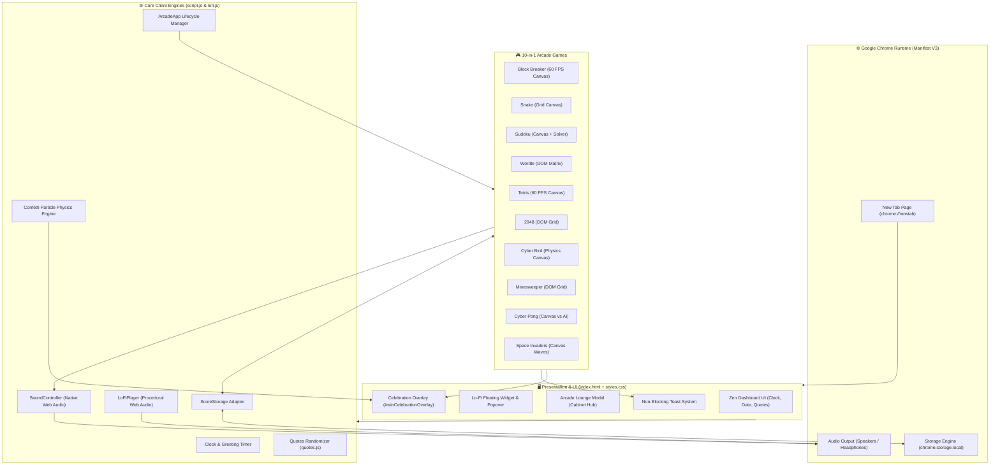

---

## 🔒 2. Security & Chrome Web Store Compliance Audit

| Security Checklist Item | Status | Verification & Evidence |
| :--- | :---: | :--- |
| **API Keys & Secrets Exposure** | 🟢 **PASS (0 Found)** | Zero API keys, JWTs, client secrets, passwords, or cloud credentials found. |
| **External Network Telemetry** | 🟢 **PASS (0 Calls)** | Zero `fetch()`, `XMLHttpRequest`, `WebSocket`, or beacon calls. No external data transmission. |
| **Dynamic Code Execution** | 🟢 **PASS (0 Found)** | No `eval()`, `new Function()`, or dynamic script string execution. Strict CSP compliant. |
| **Manifest V3 Least Privilege** | 🟢 **PASS** | Only `"permissions": ["storage"]` requested. Zero sensitive permissions (`tabs`, `webRequest`, `cookies`). |
| **Remote Script Injections** | 🟢 **PASS** | All scripts, styles, and fonts are 100% packaged locally. Zero CDN dependencies. |
| **Offline Execution** | 🟢 **PASS** | `offline_enabled: true` declared; procedural audio and games function without internet. |
| **Distribution Zip Hygiene** | 🟢 **PASS** | 22 extension files strictly bundled. Developer files, `node_modules`, and `.git` excluded (70 KB total). |

---

## 🕹️ 3. Individual Game Architecture Diagrams

---

### 1. 🐍 Snake Architecture

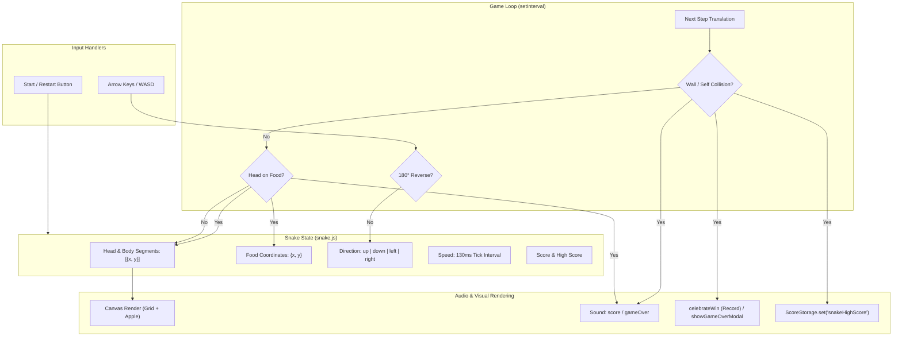

---

### 2. 🔢 Sudoku Architecture

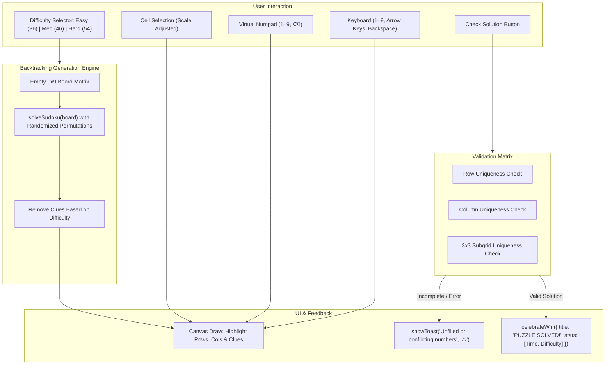

---

### 3. 🔤 Wordle Architecture

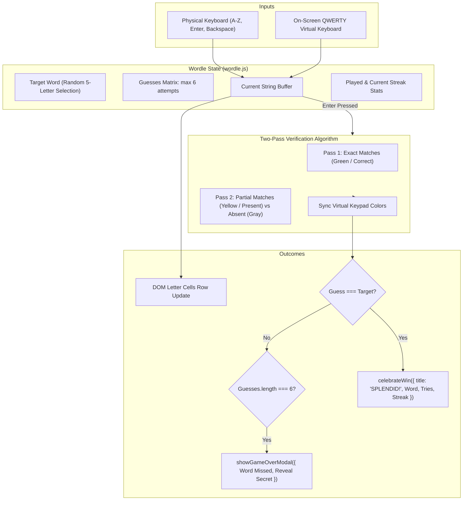

---

### 4. 🧱 Tetris Architecture

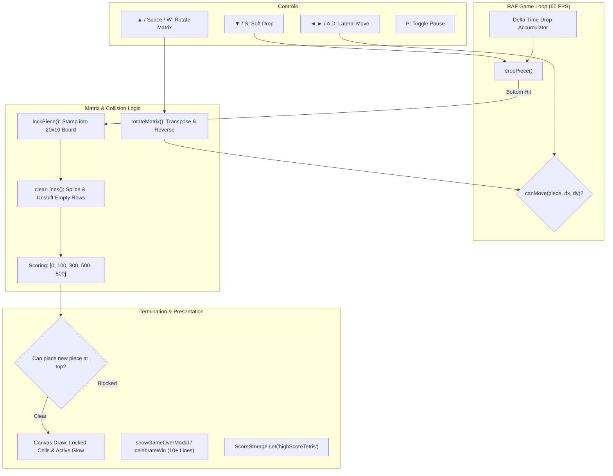

---

### 5. 🏓 Block Breaker Architecture

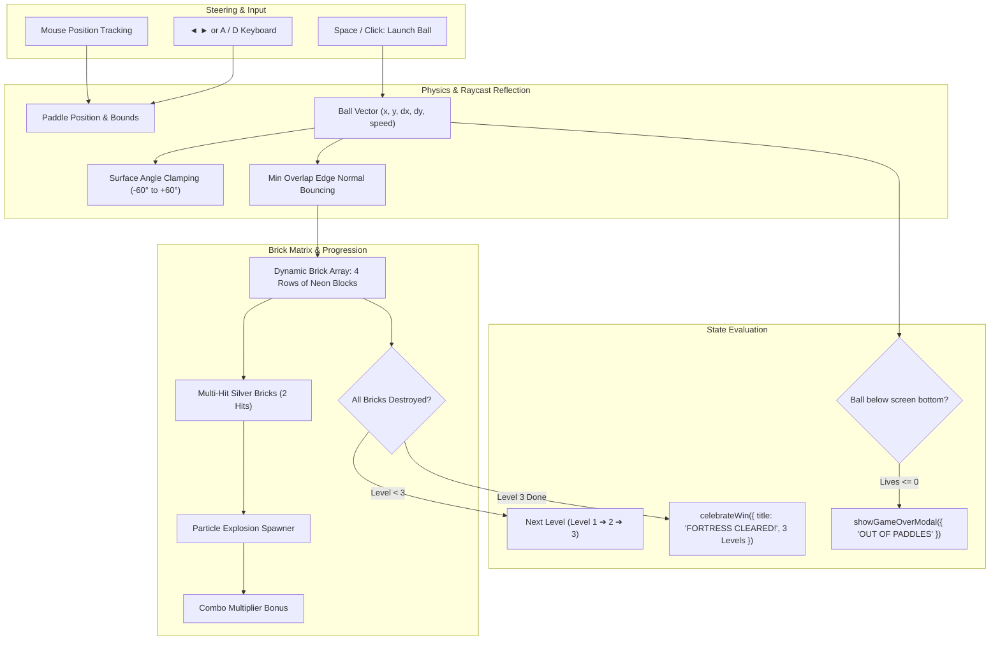

---

### 6. 🔢 2048 Architecture

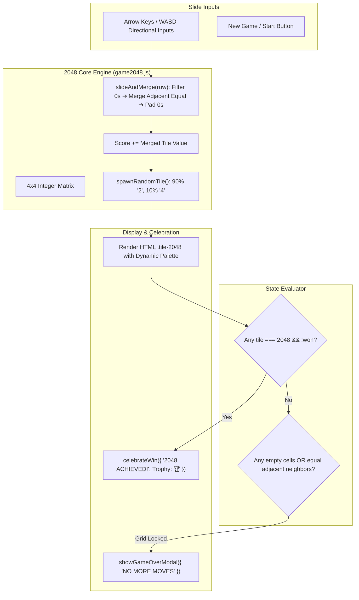

---

### 7. 🐦 Cyber Bird Architecture

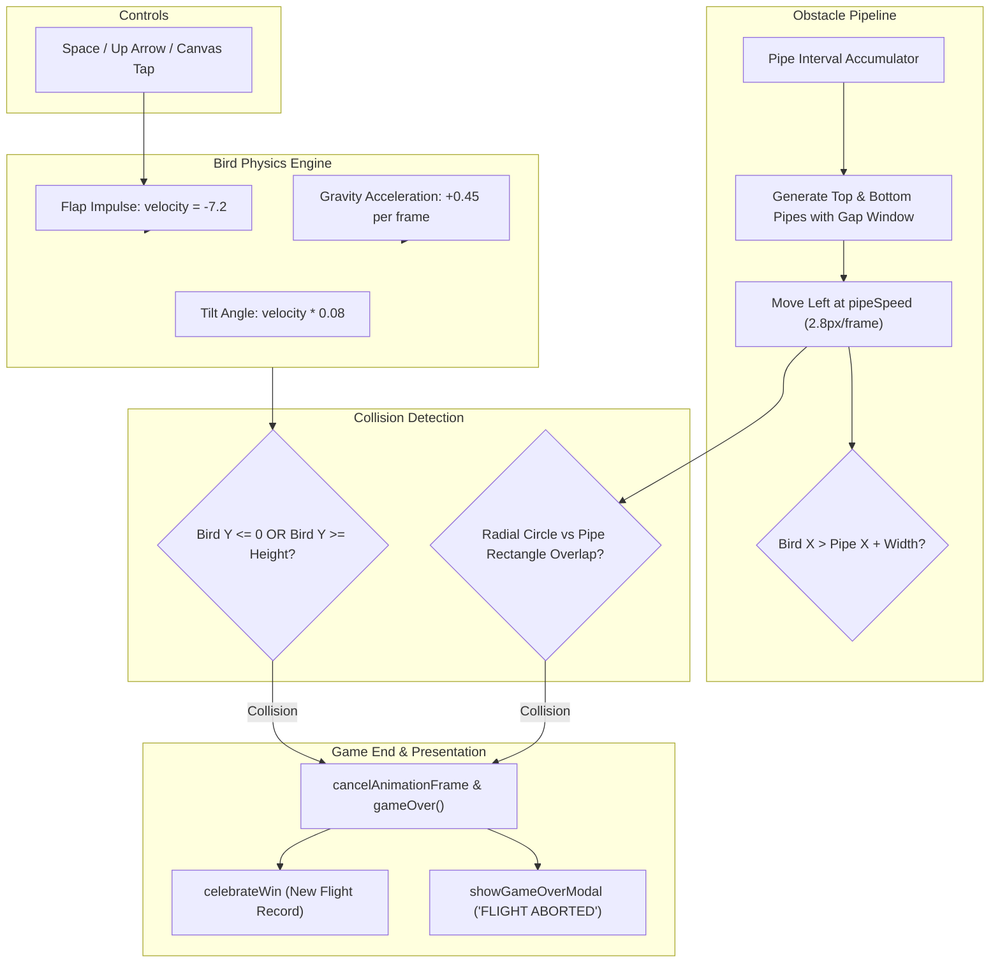

---

### 8. 💣 Minesweeper Architecture

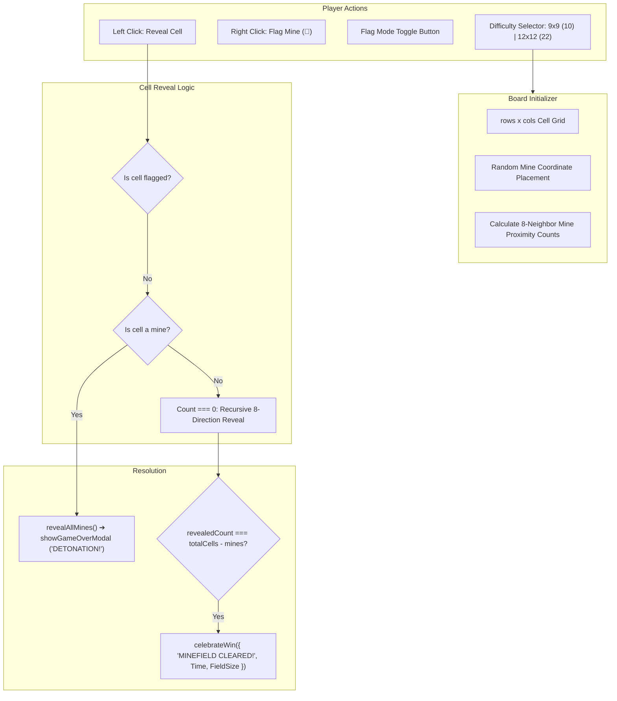

---

### 9. 🏓 Cyber Pong Architecture

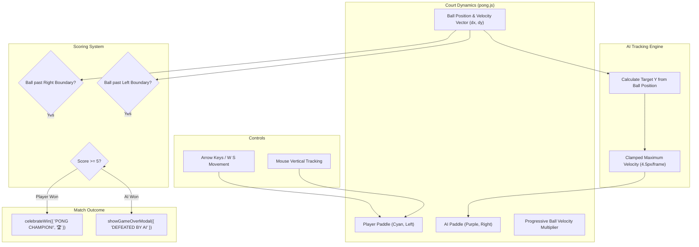

---

### 10. 👾 Space Invaders Architecture

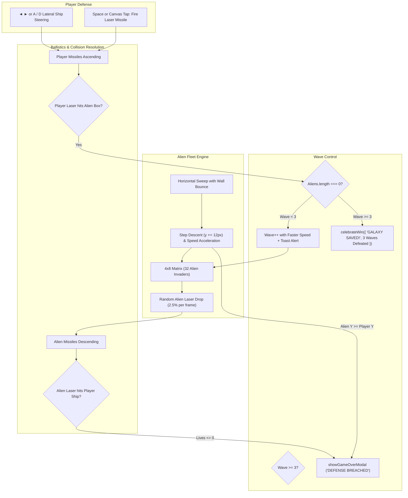
