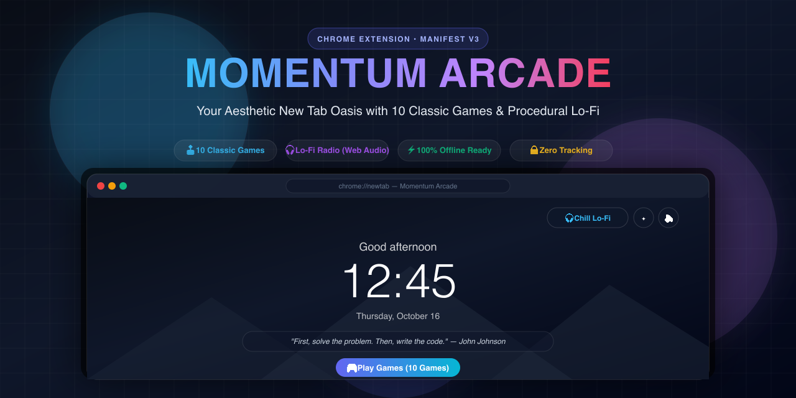
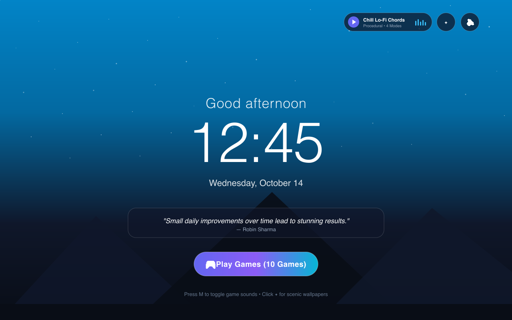
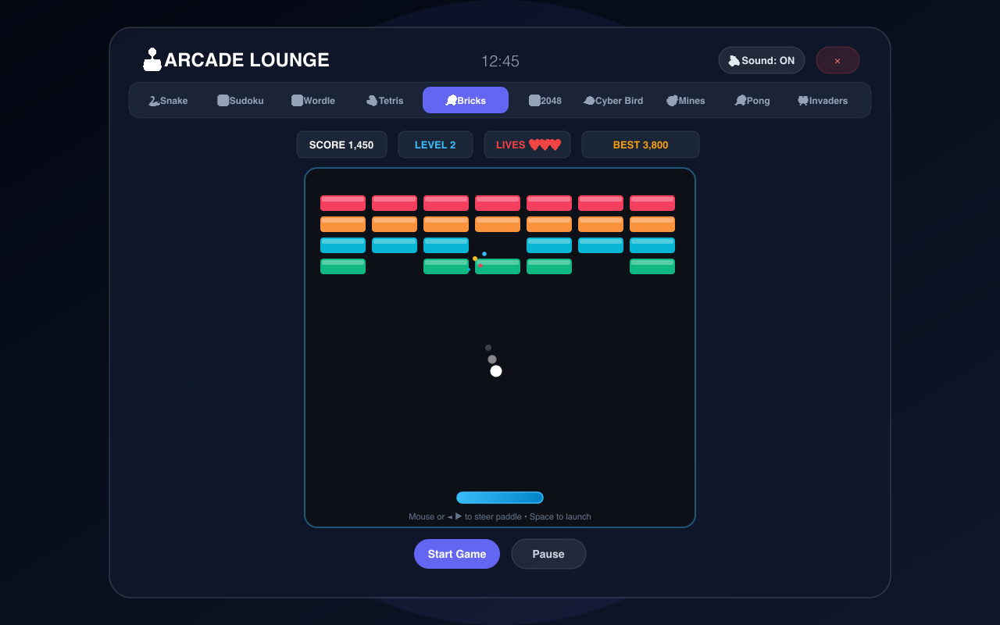
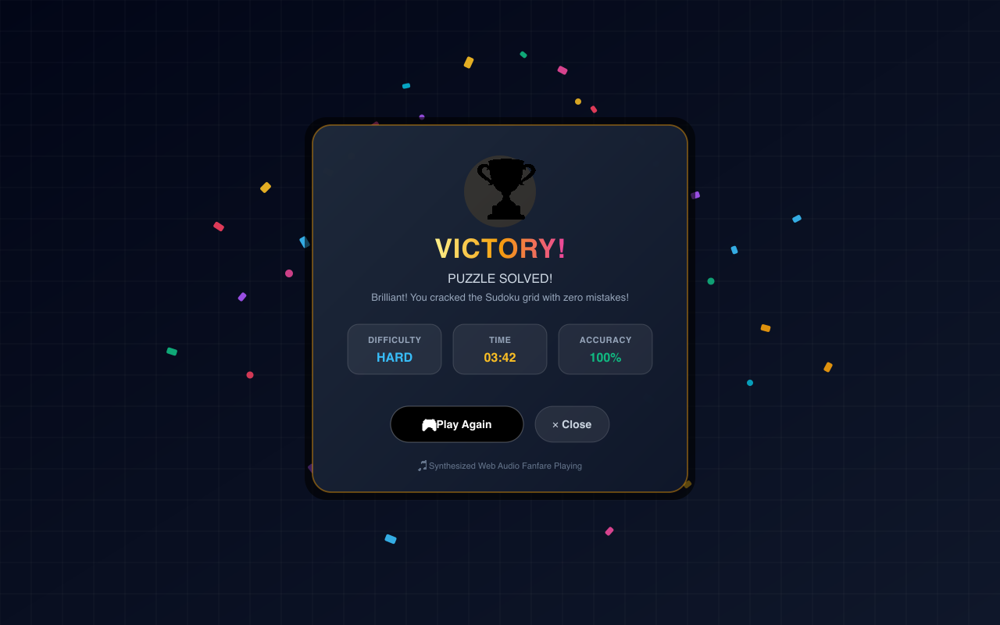
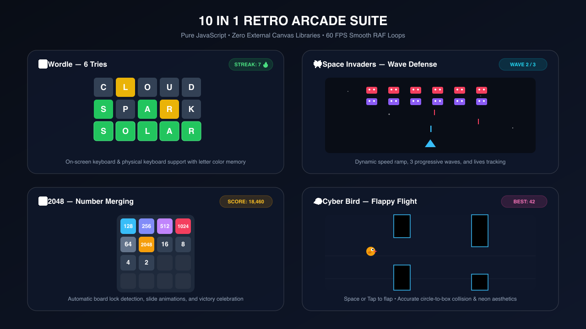

<div align="center">



# Momentum Arcade 🕹️🎧✨

**The Aesthetic New Tab Oasis for Developers, Gamers & Deep-Workers**

[](https://chrome.google.com/webstore)
[](https://developer.chrome.com/docs/extensions/mv3/)
[](https://developer.mozilla.org/en-US/docs/Web/API/Web_Audio_API)
[](package.json)
[](manifest.json)
[](LICENSE)

<p align="center">
  <a href="#-visual-tour">Visual Tour</a> •
  <a href="#-tech-stack--architecture">Tech Stack</a> •
  <a href="#-features">Features</a> •
  <a href="#-game-controls">Controls</a> •
  <a href="#-local-installation">Installation</a> •
  <a href="#-packaging">Packaging</a>
</p>

</div>

---

## 🌟 Overview

**Momentum Arcade** elevates your browser's default New Tab into an inspiring sanctuary. Instead of an empty white screen or bloated dashboard, you get:

1. **A Calm Zen Sanctuary**: Real-time adaptive greeting, minimalist digital clock, curated developer & life quotes, and dynamic scenic mountain wallpapers.
2. **Procedural Lo-Fi Soundscape Engine**: 4 ambient generative soundscapes synthesized entirely via the native **Web Audio API**—zero audio files downloaded, zero bandwidth consumed, 100% offline.
3. **Integrated Arcade Lounge (10 Classic Games)**: 10 instant retro games engineered in pure JavaScript and HTML5 Canvas running at a silky 60 FPS.
4. **Celebratory Victory & Confetti Engine**: Custom particle physics confetti bursts, trophy fanfare, and stat breakdown modals that completely replace clunky browser `alert()` popups.

---

## 📸 Visual Tour

### 1. Zen Dashboard & Generative Lo-Fi Radio
An aesthetic sanctuary featuring live clock, date, inspiring developer quotes, wallpaper switcher (`✦`), and floating Lo-Fi music player with interactive equalizer bars.

<div align="center">
  
</div>

<br/>

### 2. Retro Arcade Lounge (10 Built-In Games)
A responsive glassmorphic arcade cabinet containing 10 instant games with difficulty selectors, live high scores, and persistent state storage.

<div align="center">
  
</div>

<br/>

### 3. Victory Celebration & Physics Confetti Engine
No more blocking browser `alert()` windows! Every win triggers a custom physics-driven multi-color confetti burst, trophy fanfare, and performance stat breakdown pills with instant "Play Again" controls.

<div align="center">
  
</div>

<br/>

### 4. 10-in-1 Retro Suite Lineup
Engineered with pure Canvas and CSS grid—no external game engines, no heavy runtime libraries.

<div align="center">
  
</div>

---

## ⚡ Tech Stack & Architecture Highlights

Built with obsession for performance, clean architecture, and lightweight code:

- **🚀 Manifest V3 Compliant**: Follows Google's latest security standards with strict CSP, zero external scripts, and no remote code execution.
- **🎹 100% Procedural Audio Engine (`lofi.js` & `script.js`)**:
  - Uses native browser `AudioContext`, `OscillatorNode`, `GainNode`, and `BiquadFilterNode`.
  - Zero `.mp3` or `.wav` files! All chords, rain sounds, vinyl crackle, and game sound effects are synthesized mathematically in real-time.
  - Dedicated sound toggle button with keyboard shortcut (`M`) and master gain suspension.
- **🎮 60 FPS HTML5 Canvas Animation Loops**:
  - Delta-time normalized `requestAnimationFrame` render loops.
  - Bullet-proof state transitions preventing canvas wipe freeze conditions.
- **💾 Local-First Persistence**:
  - Unified `window.ScoreStorage` abstraction wrapping `chrome.storage.local` with automatic fallback to `localStorage`.
- **📦 Ultra-Lightweight Bundle**:
  - Entire extension zip is **under 75 KB** total! Loads in under 20ms.

---

## 🕹️ 10 Classic Games Included

| # | Game | Description | Technical Highlights |
|:---:|:---|:---|:---|
| 1 | 🐍 **Snake** | Classic slither gameplay with food eating and high score | Dynamic grid collision, variable speed ramp |
| 2 | 🔢 **Sudoku** | Grid with Easy, Medium, Hard modes and validator | Backtracking solver, cell focus, on-screen numpad |
| 3 | 🔤 **Wordle** | 6-try 5-letter word game with letter hints & streak | Color-coded keyboard cache, dictionary validator |
| 4 | 🧱 **Tetris** | Tetromino stacking, line clears, rotation & soft drop | Matrix rotation, line-clear scoring, ceiling check |
| 5 | 🏓 **Block Breaker** | Neon brick buster with 3 levels and bounce angles | Angle clamping, multi-hit silver bricks, sparks |
| 6 | 🔢 **2048** | Slide and merge tiles to build the legendary 2048 tile | Transpose matrix slides, auto gridlock detector |
| 7 | 🐦 **Cyber Bird** | Flap through neon pipes with responsive physics | Circle-to-box AABB collision, velocity gravity |
| 8 | 💣 **Minesweeper** | Clear minefields in 9x9 (Easy) or 12x12 (Hard) grids | Recursive flood-fill zero reveal, flag mode |
| 9 | 🏓 **Cyber Pong** | Fast-paced retro paddle duel against smart AI | Predictive AI paddle positioning, ball speed ramp |
| 10 | 👾 **Space Invaders** | Defend planet against descending alien armadas | 3 progressive waves, laser collision, starfield |

---

## 🎮 Game Controls Reference

| Game | Keyboard Controls | Mouse / Touch Controls |
|---|---|---|
| **Block Breaker** | ◄ ► or `A`/`D` to Move, `Space`/`W` to Launch, `P` to Pause | Move mouse over canvas to steer paddle, Click to launch |
| **Snake** | Arrow Keys or `W`/`A`/`S`/`D` to Slither | Start button |
| **Sudoku** | Arrow Keys to navigate, `1`–`9` to enter number, `Backspace` to clear | Click cell to select, Click on-screen numpad (1–9, ⌫) |
| **Wordle** | Type letters on physical keyboard, `Enter` to submit, `Backspace` to delete | Click onscreen virtual keyboard keys |
| **Tetris** | ◄ ► to Move, ▲ or `Space` to Rotate, ▼ for Soft Drop, `P` to Pause | Start and Pause buttons |
| **2048** | Arrow Keys or `W`/`A`/`S`/`D` to slide tiles | Start and Reset buttons |
| **Cyber Bird** | `Space` or ▲ to Flap | Click / Tap anywhere on canvas to flap |
| **Minesweeper** | Left Click to dig, Right Click to flag | Left Click, Right Click, or toggle Flag Mode |
| **Cyber Pong** | ▲ ▼ or `W`/`S` to move paddle | Move mouse vertically over canvas |
| **Space Invaders** | ◄ ► or `A`/`D` to Move, `Space` to Fire | Move ship, Tap canvas to shoot |

---

## 🎧 Procedural Lo-Fi Sound Modes

1. 🎵 **Chill Lo-Fi Chords & Beats**: Warm minor-seventh Rhodes jazz progressions with tape flutter and soft analog beat.
2. 🌧️ **Night Rain**: Calming rainfall generator with low-pass filtered brownian noise.
3. 📻 **Vinyl Warmth**: Authentic vinyl surface noise, crackle, and needle rumble.
4. 🧘 **432Hz Focus Drone**: Pure binaural theta wave frequency designed for flow state and deep focus.

---

## 🚀 Local Installation & Developer Setup

### 1. Clone Repository
```bash
git clone https://github.com/gnany07/momentum-arcade.git
cd momentum-arcade
```

### 2. Load Extension in Chrome
1. Open Google Chrome and navigate to:
   ```
   chrome://extensions/
   ```
2. Enable **Developer mode** (toggle switch in the top-right corner).
3. Click **"Load unpacked"**.
4. Select the `momentum-arcade` root directory.
5. Open a new tab (`Cmd+T` or `Ctrl+T`) to see Momentum Arcade!

---

## 📦 Packaging for Chrome Web Store

To build the validated production zip bundle:

```bash
npm install
npm run pack
```

This generates:
```
dist/momentum-arcade-v1.1.0.zip
```
Directly upload this file to the [Chrome Web Store Developer Dashboard](https://chrome.google.com/webstore/devconsole). For complete store listing assets and privacy questionnaire answers, see [STORE_GUIDE.md](STORE_GUIDE.md).

---

## 🤝 Contributing

Contributions, issues, and feature requests are welcome!
Feel free to check the [issues page](https://github.com/gnany07/momentum-arcade/issues).

---

## 📄 License

Distributed under the **MIT License**. See [LICENSE](LICENSE) for more information.

<div align="center">
  <sub>Built with ❤️ for deep-workers and retro gamers. Powered by HTML5 Canvas & Web Audio API.</sub>
</div>
